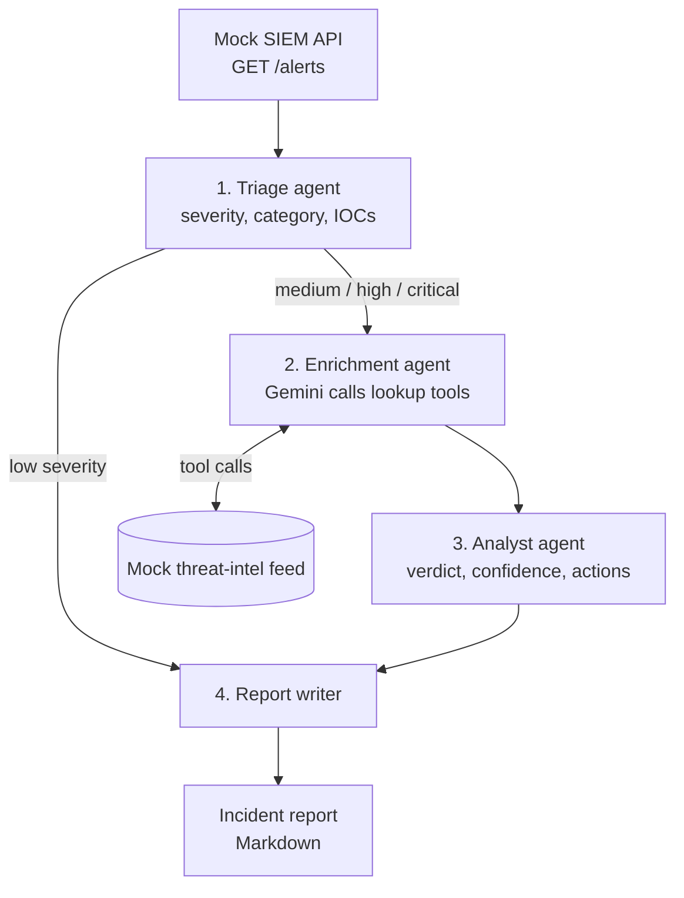

# SOC Triage Assistant


A multi-agent system that triages security alerts the way a Tier-1 SOC analyst would. It classifies each alert, checks the indicators against a threat-intelligence feed by letting an LLM choose which lookup tools to call, reaches a verdict with a confidence score, and writes a consistent incident report.

**Built with:** Python · LangGraph · Google Gemini API · FastAPI · Pydantic · pytest · GitHub Actions

All data is synthetic, and everything runs on free tools.

## The problem

Security analysts spend much of their day on repetitive triage: reading an alert, pulling out the IPs and hashes, looking each one up, deciding whether it matters, and writing it up. This project automates that loop while keeping the model's judgment visible and its claims tied to evidence.

## How it works



| Agent | LLM role | What it does |
|---|---|---|
| **Triage** | Structured output | Assigns severity and category, extracts IPs, hashes, users, and hosts |
| **Enrichment** | Tool calling | Decides which threat-intel lookups to run and runs them |
| **Analyst** | Structured output | Returns true positive / false positive / needs human review, with confidence and next steps |
| **Report writer** | Summary only | Code assembles the report; the model writes just the summary paragraph |


## Example report

Generated from a raw alert with no manual edits (full set in [`examples/`](examples/)):

```markdown
# Incident Report: ALERT-002

## Summary
An unknown executable was flagged by the endpoint agent on host LAPTOP-22. Threat
intelligence analysis confirmed that the file hash matches a known malicious trojan
of the FakeStealer family with high confidence. The alert was classified as a true
positive due to the confirmed presence of the malicious file, though execution has
not been explicitly observed and requires verification.

## Severity and Verdict
- **Severity:** High
- **Verdict:** True Positive
- **Confidence:** 85%

## Evidence
- **Type:** malware_detected
- **Host:** LAPTOP-22
- **File Hash:** 44d88612fea8a8f36de82e1278abb02f
- **Threat intel** (`lookup_hash`): reputation: malicious; confidence: 99; tags: trojan; family: FakeStealer

## Recommended Actions
- Isolate host LAPTOP-22 from the network
- Investigate the host to determine if the malicious file was executed
- Perform a forensic analysis and remove the malicious file
```

Reports are in [`examples/`](examples/):

- [`ALERT-001`](examples/ALERT-001.md): suspicious login, the full tool-calling path
- [`ALERT-002`](examples/ALERT-002.md): malware detection, with calibrated confidence
- [`ALERT-003`](examples/ALERT-003.md): low-severity alert auto-closed, honestly labelled "not assessed"